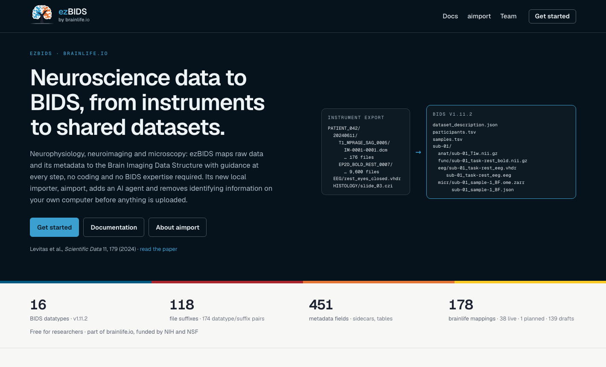

# ezBIDS

The secure, semi-automated mapping of neuroscience data (neurophysiology, neuroimaging and microscopy) to the Brain Imaging Data Structure ([BIDS](https://bids.neuroimaging.io/)) standard.  

### About

This is the repository for ezBIDS, which converts neuroscience data files (neurophysiology, neuroimaging and microscopy) to [BIDS](https://bids.neuroimaging.io/). It has two parts:

- **The ezBIDS web service**, securely hosted at [brainlife.io/ezbids](https://brainlife.io/ezbids), a semi-supervised conversion of MRI, PET and MEG data in the browser. For additional details on security features, please see [here](https://brainlife.io/docs/using_ezBIDS/#faq).
- **aimport** ([`aimport/`](aimport/README.md)), a local importer that runs on your own computer with an optional AI agent and de-identifies data before anything is uploaded. Besides MRI and PET it imports microscopy (OME-TIFF, CZI, ND2, LIF, SVS, PS-OCT, light-sheet; OME-Zarr datasets read in place) and EEG, MEG, iEEG, NIRS and EMG recordings (BrainVision, EDF, BDF, FIF, SNIRF, NWB and more), with viewers to check the result (Neuroglancer for images, a trace viewer for recordings).

Unlike other BIDS converters, ezBIDS eliminates the need for coding and command line interfaces (CLI), doing the bulk of the work behind the scenes to save users time. Importantly, ezBIDS does not require an organizational structure for uploaded data.

A series of inferenial heuritics analyze the uploaded data to provide a *first guess* BIDS structure, which is presented to users through the web-browser user interface. Users verify the *first guess* and modify the information provided as needed so as to best match the final BIDS structure. 

Data from all major scanner vendors are accepted by ezBIDS. ezBIDS enables pseudo-anonymization by providing options for the defacing of anatomical sequences, and removes all identifying metadata information (e.g. `PatientName`) before final conversion to BIDS.

The BIDS output can then be downloaded back to the user's computer, or uploaded to open repositories such as
[brainlife.io](https://brainlife.io/) or [OpenNeuro.org](https://openneuro.org/).

Helpful links:
1. [ezBIDS website](https://brainlife.io/ezbids) (Chrome or Firefox browsers preferred)
2. [ezBIDS user documentation](https://brainlife.io/docs/using_ezBIDS/)
3. [ezBIDS tutorial](https://brainlife.io/docs/tutorial/ezBIDS/)
4. [ezBIDS tutorial video](https://www.youtube.com/embed/L8rWA8qgnpo)

### Usage

To access the ezBIDS web service, please visit https://brainlife.io/ezbids. If you do not have a brainlife.io account, you will be prompted to create one for authentication purposes.

Users do not need to organize their uploaded data in any specific manner, and users may choose to compress (e.g. zip, tar) their uploaded data.

Should users feel the need to anonymize data before uploading, we strongly recommend that subjects (and sessions, if applicable) be organized into subject (and session) folders, with explicit labeling of the preferred subjects (and sessions) IDs (e.g. `MRI_data/sub-01/ses-01/DICOMS`). Failure to do so for non-anonymized data may result in an inaccurate *first guess* and require additional edits in the web browser.

If users wish to install ezBIDS locally, to ensure that data do not leave their institution site, please see [here](https://brainlife.io/docs/using_ezBIDS/#installing-ezbids-locally).

The raw JSON debug panels on the Subjects, Series and Objects pages show DICOM header values such as PatientName, PatientID and PatientBirthDate, so they are off by default, including in a local `docker compose` install. Developers can turn them on with `VITE_DEBUG=true docker compose up`.

A local, agentic alternative is in development in [aimport/](aimport/README.md) (brainlife.io/aimport): a Docker image with a loopback API that scans a folder on your own computer, proposes the BIDS mapping (with an optional language model that only sees de-identified metadata), de-identifies and defaces the data, validates it against BIDS v1.11.2 and leaves a reviewed output folder ready to upload. Nothing identifying leaves your machine. See its README for how to use it.

### Authors

-   [Daniel Levitas](djlevitas208@gmail.com)*
-   [Soichi Hayashi](soichih@gmail.com)*
-   [Sophia Vinci-Booher](sophia.vinci-booher@vanderbilt.edu)
-   [Anibal Heinsfeld](anibalsolon@utexas.edu)
-   [Dheeraj Bhatia](dheeraj.bhatia@utexas.edu)
-   [Nicholas Lee](niconal902@gmail.com)
-   [Anthony Galassi](niconal902@gmail.com)
-   [Guiomar Niso](guiomar.niso@ctb.upm.es)
-   [Franco Pestilli]([@francopestilli](https://github.com/francopestilli))
* _Both authors contributed equally to this project_

### Funding Acknowledgement

brainlife.io is publicly funded, and for the sustainability of the project it is helpful to acknowledge the use of the platform. We kindly ask that you acknowledge the funding below in your code and publications. Copy and past the following lines into your repository when using this code.

ezBIDS and aimport are developed by the Pestilli Lab at The University of Texas at Austin; please also acknowledge The University of Texas at Austin.

### Built on and how to cite

Please cite the ezBIDS paper when you publish data converted with ezBIDS or aimport:

> Levitas, D., Hayashi, S., Vinci-Booher, S., Heinsfeld, A., Bhatia, D., Lee, N., Galassi, A., Niso, G. & Pestilli, F. (2024). ezBIDS: Guided standardization of neuroimaging data interoperable with major data archives and platforms. *Scientific Data*, 11, 179. [doi:10.1038/s41597-024-02959-0](https://doi.org/10.1038/s41597-024-02959-0)

ezBIDS and aimport are developed by the Pestilli Lab at The University of Texas at Austin and built on many open-source tools. **[CREDITS.md](CREDITS.md)** lists the BIDS papers to cite for your data type and every tool we build on, with its licence and citation ([`CITATION.cff`](CITATION.cff) is the machine-readable version).

Copyright © 2022 brainlife.io at The University of Texas at Austin
