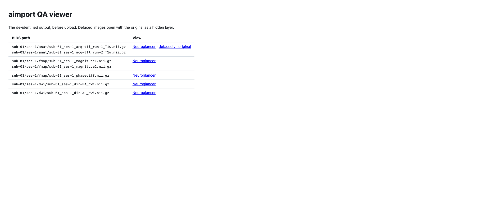
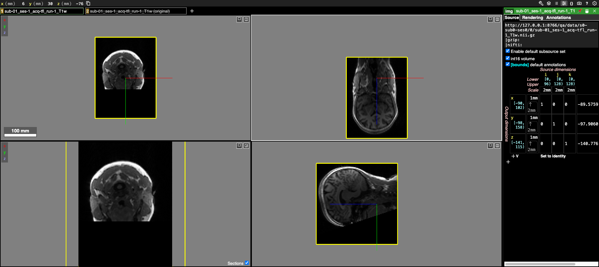

# aimport

brainlife.io/aimport is a local, agentic data importer: you point it at a folder of neuroimaging
data on your own computer, it works out what each series is, converts the data to BIDS, strips
identifiers and defaces the images, validates the result, and only then is anything uploaded to
brainlife.io. It lives in the ezBIDS repo and reuses ezBIDS's mapping, conversion and defacing tools,
but everything runs on your machine, so raw DICOMs with identifiers are never uploaded.

This directory is the engine: a Docker image and a small HTTP API on your own computer. The command
`bl aimport` (cli repo) drives it and uploads the result; the brainlife-lite `/aimport` page is upcoming (see
"What's next"). You can also drive the API directly, as shown below.

## What aimport guarantees

- **Never leaves the machine:** your input folder (mounted read-only), the original DICOM headers and
  paths, the pre-defacing images, the pseudonym key, and every identifying value found in headers or
  tables.
- **What a language model sees:** only a de-identified summary of each series (description, protocol,
  acquisition parameters, with every known identifier replaced by `[x]`). Never pixels, raw headers or
  original file paths. With no model configured, nothing is sent anywhere and the built-in heuristics do the work.
- **What is uploaded** (by the front ends, later): only the validated, de-identified output folder.
  Never the source folder, the pseudonym key or the original images.
- **Review:** nothing is written to the output until a person has seen the plan and approved it. The
  agent only proposes: every guess, subject ID, defacing choice, ancillary file and README text can be
  edited, and an edit sets the plan back to not approved.
- **Validation:** the output must pass the BIDS validator before it counts as done (stage `validated`;
  with validator errors the stage is `invalid`). A failed run leaves no output folder to upload: what it
  wrote is moved to `<work>/output/bids.failed`.
- **Limits:** redaction works from the identifiers the engine can find; see "Known limitations" below for
  what it cannot catch.

An end-to-end test (`tests/test_end_to_end.py`) plants names, IDs, birth dates and institutions in real
DICOMs and in ancillary tables, runs the whole API, and checks that none of the planted or dataset-native
identifiers appears in any model request, any output file (by path and by content, including compressed
tables and NIfTI headers) or any API response.

## Requirements

- Docker. The image is built locally and never pushed.
- Disk: the work folder holds the staged input, the converted images, the output and the pre-defacing originals.
- Apple Silicon: the image is `linux/amd64`, so it runs under emulation and is slower. Defacing is the
  slow step: `pydeface` takes about 6 minutes per T1 there and `quickshear` about 40 seconds. On Intel or Linux
  amd64 hosts both are much faster. Always pass `--platform linux/amd64`.

## Build the image

From the repo root:

```
git submodule update --init bids-specification aimport/bids-specification
docker build --platform linux/amd64 -t ezbids-handler:local handler/
docker build --platform linux/amd64 -t brainlife/aimport:dev -f aimport/Dockerfile .
```

## Run the engine

Pick three folders on the host: your data (never modified), a work folder (intermediates, the output
and the pre-defacing originals; must not overlap the others), and a keys folder (the pseudonym key; keep
it outside the work folder). Then:

```
export AIMPORT_TOKEN=$(openssl rand -hex 24)
docker run --rm --platform linux/amd64 \
  -e AIMPORT_TOKEN -e ANTHROPIC_API_KEY \
  -p 127.0.0.1:8765:8765 \
  -v /path/to/data:/data:ro -v /path/to/work:/work -v /path/to/keys:/keys \
  brainlife/aimport:dev \
  /opt/aimport-venv/bin/python -m aimport serve --input /data --work /work --keys /keys --host 0.0.0.0 --port 8765
```

- Start the engine with `/opt/aimport-venv/bin/python`: the image's plain `python` is the ezBIDS handler's
  older interpreter and cannot run aimport.
- Publish the port on `127.0.0.1` only, as above. The token is the only other protection, so never
  write `-p 8765:8765` (which listens on every network interface). Inside the container `--host 0.0.0.0` is
  allowed because `AIMPORT_IN_CONTAINER=1` is set by the image.
- Every request needs `Authorization: Bearer $AIMPORT_TOKEN`. Pass the token in the environment
  (`AIMPORT_TOKEN`), not with `--token`, which shows in the process list.
- Requests must carry a Host header of `127.0.0.1:<port>`, `localhost:<port>` or `[::1]:<port>` (anything
  else gets 421, against DNS rebinding). If you publish a different host port than `--port` (for
  example `-p 127.0.0.1:9000:8765`), use `--host-allow` (repeatable). It **replaces** the defaults, so list
  every name the client may use, e.g. `--host-allow 127.0.0.1:9000 --host-allow localhost:9000`.
- Outside the container, `--host` accepts only loopback addresses (`127.0.0.1`, `::1`, `localhost`); any
  other bind address needs `AIMPORT_IN_CONTAINER=1`.
- `--origin https://...` (repeatable) allows a web page at that origin to call the API (CORS).
- The server keeps its state in the work folder, so a restart resumes from the saved plan.

## The workflow

All examples use `T="Authorization: Bearer $AIMPORT_TOKEN"` and `U=http://localhost:8765`.

1. **Scan.** Runs ezBIDS on the staged input, asks the model about the series, builds the plan. The
   `project_id` names the pseudonym key (letters, digits, dots, dashes, underscores); `existing_subjects`
   lists subject IDs already in the brainlife project so new IDs do not collide; `existing_sessions` (subject
   ID to its session labels already in the project, e.g. `{"01": ["1", "2"]}`) does the same for session
   labels; `target` is `bids` (default) or `datatypes`.

   ```
   curl -s -X POST $U/scan -H "$T" -H 'Content-Type: application/json' \
     -d '{"project_id": "my-project", "existing_subjects": [], "target": "bids"}'
   ```

2. **Wait.** `GET /status` gives `stage` (`idle`, `scanning`, `planned`, `executing`, `validated`,
   `invalid`, `failed`), a message and warnings. `GET /events` is a server-sent-events stream of the same
   changes (it ends at `planned`, `validated`, `invalid` or `failed`). While a run is busy, editing or starting another gets 409.

   ```
   curl -s $U/status -H "$T"
   curl -sN $U/events -H "$T"
   ```

3. **Read the plan.** `GET /plan` returns the series entries and the ancillary files.

   ```
   curl -s $U/plan -H "$T"
   ```

   Fields of a series entry a reviewer can edit: `subject`, `session`, `datatype`, `suffix`, `entities`
   (for example `{"task": "rest", "run": "1"}`), `deface`, `exclude`, and the brainlife mapping
   (`brainlife_datatype`, `brainlife_tags`). Every other field is read-only and an edit to it is refused
   (422): `id`, `series_idx`, `subject_idx`, `session_idx`, `deface_opt_out` (set when a reviewer turns
   defacing off for an anatomical image; without it the writer refuses to write that image undefaced),
   `brainlife_by_person` (set when a reviewer sets the brainlife mapping; later edits keep that mapping
   until the entry's `datatype`, `suffix` or `entities` change), and
   the context the engine derives again after every edit: `source` (`heuristic`, `agent`, `person` or `none`), `confidence`, `reason`,
   `agent_note` (when the agent disagrees with the heuristic), `status` (`ok`, `unknown`, `unsupported`,
   `excluded_by_default`; secondary-capture and report series are excluded by default because identifiers
   can be burned into pixels). Plan-level fields: `dataset_name`, `readme`, `dataset_description`
   (Authors, License, Funding, EthicsApprovals, ReferencesAndLinks, DatasetDOI, HowToAcknowledge,
   Acknowledgements), `deface_method`, `warnings`.

4. **Edit.** `PATCH /plan` takes any of `edits`, `ancillary_edits`, `dataset_description`, `dataset_name`
   `readme` and `event_names`. Edits are applied all or nothing; a bad one answers 422 and changes nothing. A `subject`
   edit renames that subject in every entry; an ID the key holds for another person, or one in
   `existing_subjects`, is refused, and the new ID is recorded in the pseudonym key when the plan is
   executed (so a later import of that person gets it).

   `event_names` names the codes of EEG/MEG/iEEG/NIRS/EMG events (`{"E001": "eyes closed"}`). An event
   text is kept only when it is a safe label (a number, `Stimulus/S  1`, `BAD_*`, `Sleep stage N2`, a
   word such as `rest` or `target`, ...) holding no identifying term; any other text becomes `E001`,
   `E002`, ... and the original stays in `work/ephys/events.json`, never in the plan, the API or the
   output. A name is 1 to 40 letters, digits, spaces or `_ . / + -`; an unknown code, a bad name or a
   name holding an identifying term (also with `_ . - / +` written differently), or two codes given one name, answers 400. Kept labels are written exactly as in the recording (texts differing only in case or spacing share the label least by case-folded text). The written `trial_type` is the name. Channel names
   that hold an identifying term (or are not plain, or longer than 32 characters) are renamed
   `<type>_<NNN>`, for example `eeg_002`; 10-20 and sensor names stay.

   Electrophysiology entries (`modality: "ephys"`) are planned from the recordings' headers:
   - **Subject**: recordings in one `sub-<label>` folder are one person; when the MRI part of the same
     import used that folder, they get that MRI subject's ID. Otherwise the ID comes from the pseudonym
     key (the header's patient ID, else its name, else a run-local identity). MEG empty-room recordings
     go to the literal subject `emptyroom` (task `noise`), which is never a key or project subject and
     cannot be renamed.
   - **Session**: the input's `ses-` label when it is usable (a date-like or identifying label, such as
     MNE-BIDS's `ses-YYYYMMDD`, counts as none); otherwise `01`, `02`, ... by recording day when a subject
     was recorded on more than one day; otherwise none.
   - **Run**: the input's `run-` labels when every recording sharing a BIDS name (subject, session, task,
     acq, datatype) has a usable, distinct one; otherwise, when several share a name, `1`, `2`, ... by
     recording time.
   - `ephys_format` (editable) is the output format, one of `BrainVision`/`EDF`/`BDF` (eeg),
     `BrainVision`/`EDF` (ieeg; `NWB` for NWB input), `EDF`/`BDF` (emg), `FIF` (meg), `SNIRF` (nirs);
     `keep_headshape` (editable, meg and eeg) keeps the head-shape points, which are dropped by default.

   ```
   curl -s -X PATCH $U/plan -H "$T" -H 'Content-Type: application/json' \
     -d '{"edits": [{"id": "<entry id>", "entities": {"task": "rest"}, "exclude": false}],
          "dataset_name": "Resting-state pilot", "readme": "Pilot scans, 10 participants."}'
   ```

5. **Ancillary files.** The input's non-imaging files (participants, phenotype, README, CHANGES, LICENSE,
   CITATION, inherited sidecars, events, folders) are listed in the plan as `ancillary` entries with an
   `action` (`keep`, `drop`, `edit`), per-column actions for tables (`keep`, `drop`, `shift_date`) and
   `flags` explaining what the engine noticed. `GET /ancillary/<id>` shows the de-identified content as it
   will be written, with the reviewer's action, column choices and edited content applied (`content` is
   null for a dropped, locked or folder entry). Locked entries may only be dropped.

   ```
   curl -s $U/ancillary/a8 -H "$T"
   curl -s -X PATCH $U/plan -H "$T" -H 'Content-Type: application/json' \
     -d '{"ancillary_edits": [{"id": "a8", "columns": {"notes": "drop"}},
                              {"id": "a3", "content": "Plain text of the README"}]}'
   ```

6. **Approve.** Choose the defacing method here (see below). Any later edit un-approves the plan.

   ```
   curl -s -X POST $U/approve -H "$T" -H 'Content-Type: application/json' -d '{"deface_method": "pydeface"}'
   ```

7. **Execute.** Writes the BIDS output, defaces, validates. Poll `/status` or follow `/events` until
   `validated` (no validator errors), `invalid` (the output was written but the validator reported errors;
   it must not be uploaded: fix the plan and execute again) or `failed`. After `validated` or `invalid` the
   status has `output_dir`, `validation` with `ok`, error and warning counts and the issues, and `manifest`, the
   output files of each plan entry (`{entry_id: [paths relative to output_dir]}`). The output
   folder is `<work>/output/bids`; the pre-defacing originals go to `<work>/pre-deface`, outside it. When a
   run fails, what it wrote is moved to `<work>/output/bids.failed` (replacing an earlier one; named in the
   status message, never to be uploaded) and `<work>/output/bids` no longer exists. A failed scan names
   `<work>/ezbids.log`, where ezBIDS's own output is kept. Only the plan of the last scan can be executed: a
   new scan removes the previous plan, even if the scan then fails.

   ```
   curl -s -X POST $U/execute -H "$T"
   ```

8. **Preview.** After `validated` or `invalid`, `GET /preview/<entry id>?which=defaced|original&index=0` returns the image
   file (for a viewer such as NiiVue), so you can compare before and after defacing. It and the QA viewer's
   `/qa/data` (below) are the only routes that return image data, and only to this computer.

   ```
   curl -s "$U/preview/<entry id>?which=original" -H "$T" -o original.nii.gz
   ```

## Checking the output (QA viewer)

After `validated` or `invalid` the engine serves a Neuroglancer viewer of the output itself, so a person can look
at every written image, and at each defaced image against its original, before anything is uploaded.

1. Ask for a one-time code (bearer token, like every other call):

   ```
   curl -s -X POST $U/viewer/session -H "$T"
   # {"code": "<32 hex>", "url": "/viewer/open?code=<32 hex>"}
   ```

2. Open `$U` + `url` in a browser on the same computer within 60 seconds. The code works once; it is traded
   for a session cookie (HttpOnly, SameSite=Strict, valid until the engine stops) and the browser lands on
   `/viewer/`, the list of the written images by BIDS path. "Neuroglancer" opens an image;
   "defaced vs original" shows a defaced image next to its original. A defaced image also opens with its
   original as a hidden layer ("… (original)"): switch it on in the layer bar to compare.





What it serves, and why it stays local:

- Only the output listed in the run's manifest (`/qa/data/<entry>/<index>/…`), the pre-defacing original of a
  defaced image, and the Neuroglancer client built into the image. Never the input, `staged/`, `sourcedata/`,
  the keys folder or `scan.json`; never through a symlink or a path outside the output. Nothing is served
  before execute, or after a new scan.
- Everything comes from the engine's own origin, published on `127.0.0.1` only: no third-party viewer page and
  no request to another host. The page's Content-Security-Policy allows only the engine itself
  (`default-src 'self'`, `frame-ancestors 'none'`); the one relaxation the client needs is `'unsafe-eval'` in
  `script-src`, because Neuroglancer compiles code with `new Function` (without it the image stays blank). The token is
  never put in a URL or a page; the cookie works only on `/viewer/*` and `/qa/*`, never on the API.
- The original (pre-defacing) layer shows the face. It is for the reviewer's eyes only, to check that the
  defacing removed the face and nothing else: never screenshot or share it. Only the defaced output is
  uploaded.

## AI model settings

The model is chosen with one setting, `AIMPORT_MODEL`. The default is `claude-opus-5-5`.

| `AIMPORT_MODEL` starts with | Provider | Environment needed |
|---|---|---|
| `claude` | Anthropic | `ANTHROPIC_API_KEY` |
| `gpt`, `o1`, `o3` | OpenAI | `OPENAI_API_KEY` |
| `qwen` | Qwen through Ollama or DashScope | `OLLAMA_BASE_URL` (a local model: nothing leaves the machine) or `DASHSCOPE_API_KEY` |

Pass the variables into the container with `-e` (for a local Ollama from Docker Desktop,
`OLLAMA_BASE_URL=http://host.docker.internal:11434`). The model sees only the scrubbed view described
above, once per scan for classification and once to draft the dataset name and README. Whatever text it
returns goes through the same redaction before it is kept. If the model is not configured, or its answer
is not valid BIDS, the series keep the heuristic guess (or are marked `unknown` for the reviewer) and the
scan still finishes.

## De-identification

What the engine does, deterministically and without a model:

- Drops identifying fields following DICOM PS3.15 (a curated subset), and institution and
  operator names. Sidecars keep only acquisition parameters.
- Redacts every identifying header value (name, ID, birth date, institution) wherever it also appears in
  free text: series descriptions, protocol names, folder and file names, table cells, README text.
  Redacted text shows as `[x]`.
- Replaces subject IDs with pseudonyms; inputs already named `sub-*` keep their IDs.
- Shifts acquisition and table dates by a fixed offset per subject; intervals are kept.
- Keeps age and sex (in `participants.tsv`); ages above 89 are written as 89 (HIPAA).
- Clears NIfTI header text fields (`descrip`, `aux_file`, and the other text fields).
- Excludes secondary-capture and report series by default and flags them.
- Defaces anatomical images.

### The pseudonym key

The key (original ID to pseudonym, each subject's date offset, and each subject's session labels per
study) is one file per project, `<project_id>.aimport-key.json`, in the keys folder (mode 0600), so a later
import of the same person reuses their ID and offset, the same study keeps its session label, and a new
study gets the next free label (never one the key or `existing_sessions` already holds). A study is
recognised by its StudyInstanceUID, or by its shifted scan date when the UID was removed. The key format is
version 2; a version-1 key (from an earlier aimport, without session records) is refused with a clear error. **Keep it safe and back it up: it is the only way back to the real identities,
and it is never uploaded or written to the output** (the writer refuses to finish if a key file is found in the
output). A lock file beside it stops two imports into the same project from running at once: the second
gets 409 until the first finishes.

### Defacing

Set `deface_method` at approval; entries with `deface: true` (by default the anatomical images) are defaced.

- `pydeface` (default): registers a face template with FSL flirt. Most robust across contrasts and fields of
  view; minutes per image. Use it for the final upload.
- `quickshear`: ROBEX brain mask, then quickshear. Faster (about 40 seconds on Apple Silicon under
  emulation); a good choice for a quick check, or when pydeface fails on an unusual field of view.

Defacing is lossless outside the face: the tool's output only decides which voxels are face, those are
zeroed in the original's stored data, and every other voxel stays byte-identical (affine, shape and data type
kept). Sanity bounds reject a result that removes more than 60% of the non-zero voxels or is not a
valid NIfTI-1 image, and fail the run rather than keep a bad face mask. The originals are moved to
`<work>/pre-deface`, outside the output.

### Ancillary and metadata files

Tables are de-identified, not copied: `participant_id` values are rewritten to the pseudonyms; rows for
people who are not in this import are dropped (if no row can be linked to an imported subject the rows
are dropped and only the column descriptions are kept); columns that look identifying (name, birth date,
MRN or ID, address, email, phone, free-text notes) are dropped by default and flagged; date columns are
shifted; every text cell is redacted. The README, dataset description, sidecars and events files are
redacted. `sourcedata/` and `derivatives/` are never kept, and `code/`, `docs/` and `stimuli/` are kept
only if the reviewer opts in, with text files redacted. Three behaviours to know in review:

- **Typed text is redacted when accepted.** Anything a reviewer types (README, dataset name, dataset
  description values, edited ancillary content) is redacted with the run's identifying terms before it is
  stored, so `plan.json` and every response hold `[x]` instead of the identifier.
- **ASL is excluded by default.** `perf` `asl` (and `m0scan`, `aslcontext`) series are excluded with the reason
  "ASL needs aslcontext.tsv and labeling metadata the importer cannot derive yet", unless the input supplies an
  `*_aslcontext.tsv` (the check is for any such file in the input, not per run).
- **One README.** If the input has a README, its de-identified text becomes the plan's README (the agent drafts
  one only when there is none) and the README entry is dropped by default with the reason "used as the dataset
  README", so it is not written twice. If you set that entry back to keep, the supplied file is written as is
  and replaces the plan's README.

Entries the validator would reject for this
import (for example phenotype rows of people who are not imported, or a top-level sidecar with no matching
image) are better dropped in review; the validation result tells you which.

### Electrophysiology output

EEG, iEEG, EMG and MEG recordings are written through MNE-BIDS, one at a time, always converted to the
entry's `ephys_format` (never a copy of the source file):

- **Before writing, in memory**: renamed channels get their new names; `subject_info` keeps only sex and
  handedness; experimenter, description, project, device, helium and file/measurement IDs are cleared;
  head-shape points are dropped unless `keep_headshape` (fiducials, HPI coils and EEG electrodes stay);
  every annotation becomes its kept label or code, written as the plan's event name.
- **Dates**: MNE-BIDS anonymizes the recording date to before 1925 (the same shift for every recording of a
  subject, so intervals are kept). EDF/BDF headers say `X X X X`, `Startdate X X X X`, `01.01.85`,
  `00.00.00`. `scans.tsv` `acq_time` is the original date and time shifted by the subject's offset, as for
  MRI. The `emptyroom` subject has no key offset, so its `acq_time` is `n/a`; its folder has no session.
- **Files**: BrainVision `.vhdr` files are rebuilt with only their data, binary, channel and coordinate
  sections and the BIDS file names; `.vmrk` markers must be event names or `Stimulus/S n` codes. Every
  JSON sidecar keeps only the keys the BIDS 1.11.2 schema lists for its suffix (never the institution
  keys or `DeviceSerialNumber`) and every TSV cell is redacted. MNE-BIDS's own `participants`, `scans`,
  `README` and `dataset_description` are not used.
- **Participants**: age in whole years at the first recording, from the header's birth date (never
  written); sex from the header.
- **Final check**: every written file is read again for the run's identifying terms, the original
  dates in all their forms, copied source bytes, unexpected BrainVision sections and head-shape points
  the plan did not keep. A finding fails the run with the BIDS path and the kind of field only, and the
  partial output is removed.
- EMG placement is written as `Other` ("not recorded in the source recording").
- **Empty rooms**: each empty-room recording gets its own date shift (its own date to 1924-12-31, keeping
  only the time of day), so no real interval between rooms, or between the subjects recorded beside them,
  survives. A split FIF (above 2 GB) is saved again under its output names, so its parts still find each
  other. A session file written for several runs (`coordsystem.json`, `electrodes.tsv`, `optodes.tsv`) is
  listed once.
- **fNIRS** (SNIRF, NIRx, Hitachi): a new SNIRF 1.1 file is written with h5py from the de-identified recording
  (continuous-wave amplitude only), never copied from the input: `metaDataTags` holds exactly `SubjectID` (the
  BIDS label), `MeasurementDate` and `MeasurementTime` (`unknown`) and the length, time and frequency units;
  stim names are event names; optodes are `S<n>`/`D<n>`. MNE-BIDS then writes the sidecars, `optodes.tsv` and
  `coordsystem.json` from that file. `acq_time` in `scans.tsv` is the original date shifted, as for EEG.
- **NWB iEEG** is written as NWB by default (BrainVision or EDF on request): a new file with the
  `ElectricalSeries` samples streamed from the input (16 MiB at a time), the electrodes table (a location is
  kept only when it is made of anatomical words, else `n/a`; labels renamed by the channel rule), generated
  names for electrode groups (`group_001`), series (`ElectricalSeries`) and non-standard interval tables,
  interval tables reduced to a coded `label` column, `session_description` `n/a`, a new identifier, dates
  `1900-01-01T00:00:00+00:00`, and a subject with only the BIDS label, species and sex. No processing,
  analysis or stimulus content is written. `_ieeg.json`, `_channels.tsv`, `_electrodes.tsv` (positions converted
  from micrometres to mm), `_coordsystem.json` and `_events.tsv` are generated.
- **NWB channel types**: NWB stores no per-channel type, so each electrode group's type (sEEG, ECoG or DBS) is
  guessed from its name and description. The plan entry shows it as `channel_types` (`group_001: ecog`), and
  the reviewer can change it like any other field; it sets the channel types in the NWB-derived
  `channels.tsv` and in a BrainVision or EDF output.
- **NWB without a cached schema**: the NWB file does not embed the NWB schema (`/specifications`). The cached
  schema holds library text such as author names, which the final check cannot tell apart from personal
  names. pynwb and MNE read the file with their own installed schema. nwbinspector, and DANDI uploads, flag a
  missing cached schema; to publish on DANDI, open the file with pynwb and write it again with the schema
  cached.

### Known limitations

- A name that appears **only in free text**, with no match in any header or table the engine read, cannot be
  detected: redaction works from known identifiers. Read the README, notes and descriptions in review.
- Columns a reviewer **explicitly keeps** (against the default drop) are only redacted for known
  identifiers; other personal text in them may remain. The plan flags this.
- NIfTI-2 files are rejected (dcm2niix and this engine write NIfTI-1).
- `derivatives/` is out of scope for phase 1 and never imported.
- `bet` (FSL) is not in the image; defacing uses `pydeface` or `quickshear` only.
- Session label edits are not recorded in the pseudonym key (subject ID edits are): a later import of the
  same study gets the label the key recorded at scan time.
- `<work>/ezbids.log` (ezBIDS's own output, kept for troubleshooting) holds original paths and names, like the
  input; it stays in the work folder and is never uploaded or returned by the API.
- Phase 1 covers MRI and PET (anat, func, dwi, fmap, perf, pet) from DICOM and NIfTI; other modalities come in later phases.

## BIDS version, validator and the brainlife mapping

- Output follows **BIDS v1.11.2** (the `aimport/bids-specification` submodule at `fbe1af9a`, exported to the
  image as `/opt/bids-schema/schema.json`) and is validated with `@bids/validator` **2.4.1** (see the image
  notes below). Any validator error makes the stage `invalid`, not `validated`; warnings are listed.
- `src/aimport/data/bids_brainlife_map.yaml` maps each BIDS datatype and suffix to a brainlife datatype and tags (rows are
  `active`, `planned` or `draft`). BIDS types with no brainlife datatype get a draft in
  `src/aimport/data/datatype_drafts/`, generated by `tools/draft_datatypes.py` (see "Draft brainlife
  datatypes" below).

## Image details

- ezBIDS lives at `/app` (its `bids-specification` submodule at the pinned `3537e9ed`); aimport is in `/opt/aimport-venv` (Python 3.11), last on `PATH`, so system `python3` stays 3.8 and `pytest` is the venv's.
- `aimport/bids-specification` (submodule, BIDS v1.11.2 at `fbe1af9a`) is exported to `/opt/bids-schema/schema.json` with `bst export`.
- BIDS validator: `@bids/validator` **2.4.1** (Deno 2.5.6), run through the `bids-validator-2` wrapper. That release bundles an older schema (it flags `BIDSVersion` 1.11.2 as unknown), so the wrapper defaults `--schema file:///opt/bids-schema/schema.json` unless `--schema`/`-s` is given. Works offline. Useful flags: `--format json` (`--json` is deprecated), `--schema <URL>`, `--ignoreNiftiHeaders`, `-o <file>`.
- Test data: `tests/fixtures/fetch_dcm_qa.py` fetches `neurolabusc/dcm_qa_xa30` at a pinned commit and plants fake PHI.
- Python packages are installed exactly as `uv.lock` pins them (with hashes); the Deno download is checked against its sha256.
- Microscopy (`micr`) packages, locked for Python 3.11 (the image): bioio 3.7.1, bioio-czi 4.1.0 (aicspylibczi), bioio-nd2 2.5.0, bioio-lif 2.0.1, tifffile 2026.3.3, ome-types 0.7.0, zarr 3.1.6, fsspec[http] 2026.9.0, dask[array] 2026.11.0, ngff-zarr 0.53.0, scipy 1.17.1, h5py 3.16.0. All have wheels for manylinux x86_64 and macOS arm64.
- Electrophysiology and optical (`eeg`, `meg`, `ieeg`, `nirs`, `emg`) packages, locked for Python 3.11 (the image): mne 1.13.2, mne-bids 0.20.0, edfio 0.4.18 (EDF/BDF export), pybv 0.8.1 (BrainVision export), defusedxml 0.7.1, pynwb 4.2.0, matplotlib 3.11.2 (h5py 3.16.0 as above); neo 0.14.6 is the optional extra `aimport[neo]` (Blackrock) and is not in the image. All have wheels for manylinux x86_64 and macOS arm64 (pure Python, or binary wheels for matplotlib, contourpy, kiwisolver, pillow and rpds-py).
- Ephys capability ruling (Task 1, `tests/test_ephys_capability.py`), which sets `ephys.OUTPUT_FORMATS` and `ephys.MNE_READERS`:
  - every reader family resolves in MNE 1.13.2, MEF3 included (`read_raw_mef`); that reader imports `pymef` (MNE's optional extra, not an aimport dependency) when it opens a file, and neo has no MEF3 reader, so MEF3 input cannot be read in the image as it stands;
  - MNE-BIDS anonymize with an explicit `format=` writes new files (no output byte-identical to the source) for eeg-BrainVision, eeg-EDF, ieeg-BrainVision (EDF source) and meg-FIF (CTF source);
  - MNE-BIDS writes `datatype="emg"` as EDF and as BDF (`emg_placement` is required), and EEG as BDF, so BDF stays an output format;
  - MNE-BIDS writes NIRS from an h5py-written SNIRF with `anonymize=None`: `_nirs.snirf`, `_nirs.json`, `_channels.tsv`, plus `sub-<label>_optodes.tsv` and `sub-<label>_coordsystem.json` (no task entity);
  - the pinned validator passes the bids-examples `eeg`, `ieeg`, `meg` (`ds000247`), `fnirs` and all eight `emg_*` sets with bids-examples' CI flags (`--config default-config.json`, which ignores `EMPTY_FILE`, and `--ignoreNiftiHeaders`).
- OME-Zarr output is NGFF **0.5** (Zarr v3, sharded) by default; set `AIMPORT_NGFF_VERSION=0.4` for Zarr v2. The validator ruling behind the default (Task 1, `tests/test_micr_validator.py`): `@bids/validator` 2.4.1 on schema 1.11.2 accepts NGFF 0.5, NGFF 0.4 and metadata-only stores (chunks deleted). It treats a `.ome.zarr/` directory as opaque: it rejects only an empty directory (`EMPTY_FILE`) and never reads `zarr.json`/`.zattrs` (a corrupt `zarr.json` passes, and sidecar `PixelSize` is not compared with the NGFF scale), so aimport checks its own OME-Zarr metadata.
- Remote microscopy sources (`micr/remote.py`): only `https://` and `s3://` URLs (`s3://b/k` is read as `https://b.s3.amazonaws.com/k`), anonymous, with no user information, query, IP-literal or `localhost` host; redirects are followed only to the same origin or an `https` `*.amazonaws.com` host. Discovery probes `<url>/zarr.json`, then `<url>/.zattrs`, then the extension or `Content-Type`; only OME-Zarr, NIfTI and TIFF are accepted. Every read is an HTTP range request counted by a `ByteCounter` (which can cap it): an OME-Zarr store is read through zarr (metadata and the chunks asked for), a file through 64 KiB blocks, and nothing is downloaded whole. Counting the pages of a remote multi-page TIFF walks its IFD chain (one range read per page).
- Microscopy plan entries (`micr/module.py`): the scan writes `work/micr/records.json` (local only, like `claim.json`: paths, URLs, name facts and image facts, acquisition date included), one record per image or tile group (VISoR and numbered tiles of one folder share one, raw PS-OCT `.dat` tiles one per folder). Plan entries carry only generated values: `subject_idx`/`series_idx` from 1,000,000 up, subject IDs from the pseudonym key (original `micr:id=<donor>`), samples `slice<NNN>`, the input's `sample-` label or `1, 2, ...`, `acq-<PS-OCT contrast>`, `stain-ch<nm>`, `chunk-<position or tile>` when a sample has several, a suffix from names (`OCT`, `SPIM`) or the OME acquisition mode, and a description built from the image facts. `write_mode` is `reference` for OME-Zarr (no copy, `output_bytes` 0) and `convert` otherwise (`output_bytes` = level 0 x 1.34). A remote source's donor comes from its file or store name or one of its three nearest folders, never from the bucket or the leading segments of the URL. A remote VISoR tile is planned from its first page and `frames_per_file`. Module planners run after the MRI subjects took their IDs, so MRI subject IDs and session labels are those of an MRI-only plan. Microscopy entries stay `micr` (another datatype makes them unknown, as does `micr` on an MRI entry); `sample_type` (default `tissue`) is editable within the BIDS enum. A microscopy-only scan has no DICOM-header warning; a supplementary folder (such as `sourcedata/`) holding claimed input is left out with a warning giving the count.
- Microscopy conversion (`micr/convert.py`, `micr/metadata.py`): each included `convert` entry becomes `sub-<s>[/ses-<s>]/micr/<name>.ome.zarr` plus its sidecar. Pixels are read block by block (a block never larger than `MAX_BLOCK_BYTES`, 256 MiB, read at call time) and a whole array is never in memory. Level 0 is written in slabs along the slowest spatial axis, full extent on the others and one shard deep, in order, so each source block (strip, plane stack) is read once (the last one is kept for the next slab); when such a slab does not fit half the block limit, the shard gets thinner along that axis (chunks down to an eighth of the default) if that makes it fit, else the slabs are as deep as fits and cut through shards, which zarr completes by read-merge-rewrite one shard at a time; only a single slice larger than half the limit falls back to shard-by-shard writing. Remote files are read with a 4 KiB read-ahead while converting. Level k of the pyramid is the 2x box mean of level k-1 as written (exact integer arithmetic, majority vote for booleans; y and x every level, z only while its pixels are not coarser than the plane), down to a largest axis of 512 or 8 levels. ngff-zarr creates each level's array (metadata only); chunks are `(1, 128, 128, 128)` (3D) or `(1, 1024, 1024)` (2D) with 4 chunks per spatial axis per shard (0.5), fewer per shard (z first) when a shard would exceed half the block limit. The group metadata is then rebuilt from the allowlisted image facts only (`ngff_attrs`: axes, scale per level, an `omero` channel `ch<nm>`/`ch<i>` per channel with the coarsest level's 0.5/99.5 percentile window; no name, OME-XML or library metadata), and the array attributes are emptied. **Pixel size is never invented:** plan entries carry `pixel_size` (x, y[, z]) and `pixel_size_units` (`mm`, `um`, `nm`) from the source; when the source lacks any spatial axis the entry is `unknown` ("pixel size unknown: set it in the plan") until the reviewer sets both (editable on microscopy entries only, positive finite numbers, one per spatial axis), and the writer refuses an entry without them. The sidecar holds that `PixelSize`/`PixelSizeUnits`, `Magnification`, `NumericalAperture` and `Immersion` when known, and for `OCT` `OCTContrast`, `OCTRetardanceKind` and `OCTOpticAxisConvention` (`n/a`). Several files that are tiles of one plane (not VISoR frame stacks) are planned `unsupported` ("tile mosaic: stitch first ..."); VISoR tiles of one position are stacked along z. After each image aimport re-opens it (zarr and ngff-zarr, NGFF structural rules) and checks the group metadata for the configured version, the axes and units, level 0's scale against the sidecar `PixelSize`, each level's shape and dtype, and the omero channel count; a failure fails the execute with a generic message. The writer adds a participants row (`n/a` age and sex; MRI demographics win; the `sex` description says when it is not from DICOM), `samples.tsv` (`sample_id`, `participant_id`, `sample_type`; merged with a supplied one by participant and sample, supplied values winning) and `scans.tsv` rows whose `acq_time` is the image's acquisition date (else the date in its name) shifted by the subject's offset, date only (`T00:00:00`, described in `scans.json` as "date only for microscopy images; time not recorded"). A BIDS-named input's own suffix and entity keys (`sub-01_sample-A_CONF`) are vocabulary, not identifying terms; its `sample-`/`sub-`/`ses-` labels are used only when they are not terms. A reference (below) is checked the same way, from its metadata only.
- Microscopy reference datasets (`micr/reference.py`): an OME-Zarr input (`write_mode` `reference`) is never copied or converted. Under `bids/` aimport writes only new metadata: the group attributes rebuilt by `ngff_attrs` in the **source's** Zarr format (v3 → NGFF 0.5, v2 → 0.4; the chunks are not re-encoded), with the plan's pixel size, each level's factor from its size (the source's scale when the size agrees with it), and the source's omero windows when they are four numbers per channel (else the dtype's range); and per level a `zarr.json` or `.zarray` rebuilt from the source array's structure (shape, data type, chunk grid, key encoding or separator, codecs or compressor and filters, fill value, order), with `attributes` dropped and dimension names set to the image axes. Arrays are stored at `0`, `1`, ...; no chunk is written or read (the source's chunks may be absent), and the source's `OME/` folder, consolidated metadata and array attributes are not written. Where the chunks are is in the **chunk map** `work/output/bids.chunks.json` (never under `bids/`; local only, like `records.json`, and never uploaded): `{"version": 1, "arrays": {"<array dir under bids/>": {"source": {"input": "<input-relative dir>"} | {"url": "<https URL>"}, "zarr_format", "shape", "chunk_grid" (the stored object: shard or chunk), "separator", "codec_bytes_hint" (that object's decoded bytes), ["key_encoding": "v2"]}}}`. A chunk key under an array is the same in the source and the output; `chunk_keys` lists them (a missing source object is the fill value), and `resolve(map, out_rel, input_dir)` (shared by the engine and the viewer) maps an output chunk path to its source, refusing a path not strictly inside a mapped array, a key that is not one of that array's chunk keys, an input source outside the input folder or through a symlink, and a URL `normalize_url` refuses. `output-state.json` gains `"chunk_map": "output/bids.chunks.json"` and `/status` shows that path only; a new scan and a failed execute remove the map. An OME-Zarr whose axes would need a squeeze or transpose, or with storage transformers or an irregular chunk grid, fails the execute.
- QA viewer client: a standalone build of the `neuroglancer` npm package **2.41.2** (`viewer-client/`: vite, as in
  neuroglancer's `examples/vite`; only the NIfTI source over http and image layers are included), made by a node
  build stage with `npm ci` from `viewer-client/package-lock.json` (integrity hashes) into `/opt/neuroglancer-client`
  and served at `/viewer/ng/`. On the host, build it with `cd viewer-client && npm ci && node build.mjs <dir>` and
  set `AIMPORT_NEUROGLANCER_DIR=<dir>`. neuroglancer's icon dependency `ikonate` is a GitHub commit, pinned in
  `package.json` `overrides` to that commit's codeload tarball; its lockfile integrity is the hash of an archive
  GitHub generates, so `npm ci` fails if GitHub ever regenerates it differently (then update the hash after
  checking the archive's contents).

## Defacing details

`aimport.deface.deface` defaces the images of plan entries with `deface=True` (found through the manifest `write_bids` fills), moving the originals to a folder outside the BIDS folder and keeping affine and shape. Choose with `Plan.deface_method`:

- `pydeface` (default): registers to a face template with FSL flirt. Most robust across contrasts and fields of view; minutes per image. Use it for the final upload.
- `quickshear`: ROBEX brain mask, then quickshear. Needs no registration (about 40 seconds per T1 under emulation on Apple Silicon); a good choice when pydeface fails on an unusual field of view.

The tool's output only decides which voxels are face: those are zeroed in the original's stored data and every other voxel stays byte-identical (no re-quantisation).

Unlike ezBIDS, no `fslreorient2std` is applied. Docker tests: `quickshear` runs under `-m docker`; the pydeface test is `-m docker_slow`.

## Draft brainlife datatypes

BIDS raw-data types that have no brainlife datatype get a draft in `src/aimport/data/datatype_drafts/` (warehouse `Datatypes` shape, named `neuro/<datatype>/<suffix lowercased>`), plus a `status: draft` row in `src/aimport/data/bids_brainlife_map.yaml`. Drafts are to be registered later through a PR to brainlife; check the registry for an existing datatype first. The engine ignores them for uploads (`to_brainlife` returns `(None, [])`; `draft_for` returns the draft name).

Regenerate after changing the schema submodule or an active/planned row (output is deterministic, so no change means no diff):

```
cd aimport && uv run python tools/draft_datatypes.py --write-yaml
```

`--schema PATH`, `--out DIR` and `--yaml PATH` override the defaults; without `--write-yaml` the YAML rows are printed. A pair is covered (no draft) when an active or planned row has the same BIDS datatype and either the same suffix or no suffix (the 18 `micr` image suffixes are active rows to `neuro/ome-zarr` tagged with the suffix; `micr/photo` has a planned placeholder row with no brainlife datatype, so it gets no draft and is never mapped).

Rules for the files of a draft:

- One entry per schema extension. Directory extensions (ending in `/`) become `dirname` entries. Wildcard (`.*`) and bare `/` extensions name no concrete file and are skipped; the only effects are that `meg/headshape` lists just `.pos`, and that the `/` extension of `meg/meg` is not drafted (that pair has planned `.ds`/`.fif` rows, so it gets no draft anyway; other MEG formats are not drafted).
- Data formats: non-sidecar extensions (sidecars are `.json`, `.bval`, `.bvec`) are grouped into alternative formats. `.nii.gz`/`.nii`, BrainVision `.vhdr`+`.eeg`+`.vmrk` and EEGLAB `.set`+`.fdt` each count as one format; any other extension is a format of its own.
- A suffix with a single format requires the first extension of that format (e.g. `.nii.gz`). A suffix with several formats (e.g. NIfTI or OME-Zarr; `ieeg` `.edf`/BrainVision/`.mefd`/...) requires none of them; `desc` and the readme say "Exactly one of: ... must be present".
- `.json` is required when `rules.sidecars` has unconditional required metadata for the pair (selectors decidable from datatype, suffix, modality and extension only; entity- or sidecar-conditional entries are ignored). Otherwise it is optional. When a `.json` extension exists, `bids.maps` sets `json: <suffix>.json` on the main file of each format.
- The readme lists the other raw suffixes of the same BIDS datatype as related files; they are separate datatypes.
- `draft` and `bids_version` are extra keys for tooling; the warehouse model drops unknown keys at registration.

## Test datasets and running the tests

The datasets used, their pinned versions and the planted identifiers are listed in
[tests/DATASETS.md](tests/DATASETS.md).

Host (no Docker needed):

```
cd aimport && uv run pytest -m "not docker and not docker_offline and not docker_slow"
```

In the image (needs network the first time, to fetch the pinned test DICOMs, which are cached):

```
docker run --rm --platform linux/amd64 -v $PWD/aimport:/src \
  -v ~/.cache/aimport-dcm-qa:/tmp/aimport-dcm-qa-cache brainlife/aimport:dev pytest -m docker /src/tests
docker run --rm --platform linux/amd64 -v $PWD/aimport:/src brainlife/aimport:dev pytest -m docker_slow /src/tests  # pydeface, minutes
```

The end-to-end leak test is `tests/test_end_to_end.py` (about two minutes under emulation).

## What's next

`bl aimport` in the [brainlife cli](https://github.com/brainlife/cli) (branch `aimport-cli`, pending release) is the
command-line front end: it runs this image, shows the plan in the terminal, runs the brainlife datatype
validators on your host and uploads the result. Run `bl aimport <folder> --project <id>` (see the cli README).
The brainlife-lite `/aimport` page (plan review with image previews) is still upcoming.
**Uploading to brainlife.io happens in those front ends, not in this engine**: the engine only produces the
validated, de-identified output folder.
